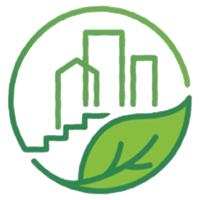
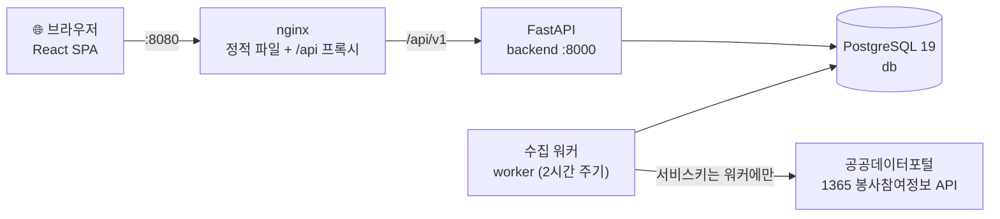
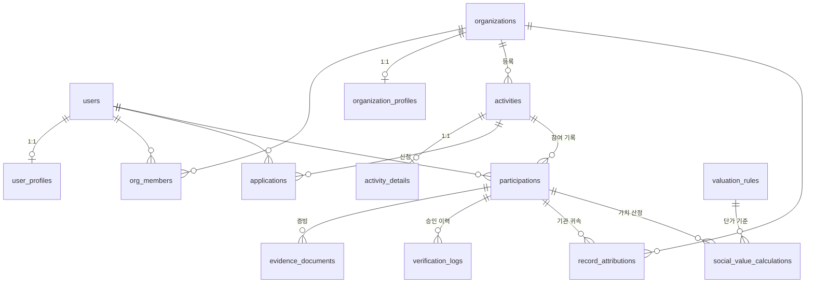

<div align="center">



# GreenStep

**함께하는 시간, 남겨지는 가치.**

청년의 봉사활동을 **사회적 가치(원)** 로 환산해 **봉사 이력서**를 발급하고,<br />
기관에는 그 성과를 정리한 **ESG 경영 보고서**를 제공하는 사회적 가치 전환 플랫폼


<sub>팀 아이스볼 · ESG 소프트웨어 창업 수업 프로젝트</sub>

</div>

---

## 목차

1. [서비스 소개](#-서비스-소개)
2. [주요 기능](#-주요-기능)
3. [사회적 가치(SROI) 산정](#-사회적-가치sroi-산정)
4. [기술 아키텍처](#-기술-아키텍처)
5. [데이터베이스](#-데이터베이스)
6. [API](#-api)
7. [1365 봉사 공고 수집 워커](#-1365-봉사-공고-수집-워커)
8. [폴더 구조](#-폴더-구조)
9. [실행 방법](#-실행-방법)
10. [구현 현황](#-구현-현황)

---

## 🌱 서비스 소개

> 청년이 쌓은 봉사 시간은 "몇 시간 했다"로만 남고, 기관이 만든 사회공헌 성과는 숫자로 보여 주기 어렵습니다.
> **GreenStep**은 같은 활동 기록을 양쪽 모두에게 쓸모 있는 증빙으로 바꿉니다.

| 사용자 | 겪는 문제 | GreenStep이 주는 것 |
| --- | --- | --- |
| 🧑‍🎓 **청년** | 봉사 경험을 이력서에 설득력 있게 담기 어려움 | 기관이 승인한 기록만 모은 **봉사 이력서** (A4, 확인번호로 진위 조회) |
| 🏢 **기관** | 봉사 프로그램 성과를 ESG 보고에 쓸 근거가 부족함 | 활동 등록·기록 승인·집계와 **ESG 경영 보고서** 발행 |

사이트는 1365 자원봉사포털처럼 맨 위 탭으로 두 포털을 나눕니다.

| 포털 | 대상 | 메뉴 |
| --- | --- | --- |
| **Green청년** | 개인(청년) 회원 | 봉사활동 찾기 · 봉사 이력서 · 고객지원 |
| **Green기관** | 기관 담당자 | 기관 대시보드 · 활동 관리 · ESG 경영 보고서 · 고객지원 |

> [!NOTE]
> 수업 시연용 프로젝트입니다. 화면 속 기관과 공고(1365 수집분 제외)는 예시이며, 실제 모집·인증 서비스는 제공하지 않습니다.

---

## ✨ 주요 기능

### Green청년

- **봉사활동 찾기** — 키워드·분야·지역·정렬·마감 임박 필터, `GreenStep 공고` / `1365 공고` 탭
- **활동 상세** — 산정 기준과 예상 사회적 가치 계산기. 1365 공고는 출처를 표기하고 1365 원문 신청 링크로 안내
- **활동 기록 제출** — 참여 기록을 제출하면 기관이 승인. 1365 확인서 기록은 `검증 대기` 상태로 따로 관리
- **봉사 이력서** — 기관 승인 기록만으로 A4 이력서 발급, 확인번호 부여, `/verify`에서 진위 조회
- **마이페이지** — 오른쪽 위 `홍길동님 · 마이페이지`에서 신청 내역·누적 가치·프로필 관리

### Green기관

- **기관 회원가입** — 사업자등록번호 등 기관 정보 입력 → 운영자 **심사 대기** → 승인 후 공고 등록 가능
- **기관 전용 로그인** (`/org/login`) — 청년 로그인과 분리된 페이지, 상단 메뉴 없이 로그인만
- **활동 관리** — DB 컬럼과 1:1로 맞춘 공고 작성 폼, 임시저장·게시·마감, 난이도 가중치 자동 후보 표시
- **기관 대시보드** — 승인 대기 기록 승인/반려(사유), 일괄 승인, KPI
- **ESG 경영 보고서** — 월별·활동별 집계, 워터마크 미리보기 → 결제(데모) → 발행(확인번호 `GS-YYYY-xxxx-XXXX`)

> [!IMPORTANT]
> 집계·이력서·보고서에는 **기관이 승인(APPROVED)한 기록만** 반영합니다. 기관의 ESG 등급은 매기지 않습니다.

---

## 💰 사회적 가치(SROI) 산정

```text
사회적 가치(원) = 활동 시간 × 표준 단가 × 기관 가중치
```

| 항목 | 기준 |
| --- | --- |
| 표준 단가 | 2026년 최저임금 **10,320원** / 돌봄·보육 분야 **11,120원** |
| 기관 가중치 | 1.0 ~ 1.5. 신규 활동은 난이도 키워드로 **자동 후보만 표시**, 운영자 확인 전에는 **1.0** 적용 |
| 스냅샷 | 단가·가중치는 기록 제출 시점 값으로 고정 (나중에 기준이 바뀌어도 과거 기록은 그대로) |

> 예) 돌봄 활동 4시간, 가중치 1.0 → `4 × 11,120 × 1.0 =` **44,480원**

---

## 🏗 기술 아키텍처



> [!TIP]
> 외부 API 서비스키는 **서버(워커)에만** 둡니다. 브라우저는 우리 API만 호출하므로 키가 노출되지 않습니다.

### 기술 스택

| 영역 | 기술 |
| --- | --- |
| **프론트엔드** | React 18.3 · TypeScript 5.6 · Vite 6 · Tailwind CSS 4.1 · React Router 6 |
| **백엔드** | FastAPI · SQLAlchemy 2 · Alembic · Pydantic 2 · psycopg 3 |
| **인증** | argon2 비밀번호 해시 · JWT (access 토큰은 메모리, refresh 토큰은 httpOnly 쿠키) |
| **DB** | PostgreSQL 19 |
| **수집 워커** | Python 3.13 · requests · psycopg 3 |
| **인프라** | Docker Compose (web · backend · db · worker) · nginx |

### 컨테이너 구성

| 서비스 | 이미지 / 빌드 | 역할 | 포트 |
| --- | --- | --- | --- |
| `web` | `web/Dockerfile` (node 빌드 → nginx) | React 정적 파일 제공, `/api/` 를 backend로 프록시 | `8080` |
| `backend` | `backend/Dockerfile` | 시작 시 `alembic upgrade head` → 데모 시드 → uvicorn | 내부 `8000` |
| `db` | `postgres:19` | 데이터 저장 (볼륨 `pgdata`) | `127.0.0.1:5433` |
| `worker` | `api/Dockerfile` | 1365 봉사 공고를 2시간마다 수집해 DB에 저장 | — |

### 프론트엔드 API 모드

같은 `Api` 인터페이스를 두 가지로 구현해 두었습니다. `VITE_API_MODE` 로 고릅니다.

| 모드 | 동작 | 용도 |
| --- | --- | --- |
| `http` (Docker 기본) | FastAPI `/api/v1` 호출, 실제 DB 사용 | 실제 연동 |
| `mock` | 브라우저 localStorage 안에서 서버를 흉내 냄 (권한 검사 포함) | 백엔드 없이 전체 흐름 시연 |

---

## 🗄 데이터베이스

노션 「GreenStep_기술_아키텍처」의 **1. 회원·기관 DB** 표와 ERD를 기준으로 만들었습니다.
테이블 정의 원본은 [`backend/alembic/versions/0001_initial_schema.sql`](backend/alembic/versions/0001_initial_schema.sql) 입니다.



| 구분 | 테이블 |
| --- | --- |
| **노션 기준 11개** | `users` · `organizations` · `org_members` · `activities` · `applications` · `participations` · `evidence_documents` · `verification_logs` · `record_attributions` · `valuation_rules` · `social_value_calculations` |
| **확장 3개 (1:1)** | `user_profiles` (학교·희망 분야·마케팅 동의) · `organization_profiles` (기관 소개) · `activity_details` (한 줄 소개·회당 시간·대상·수행 업무·가중치·조회수) |
| **수집 워커용 2개** | `sync_runs` (수집 실행 기록) · `external_sync_state` (상세조회 시각) |

### 웹 입력 ↔ 테이블

| 화면 | 저장 위치 |
| --- | --- |
| 청년 회원가입 | `users` (email, password_hash, name) + `user_profiles` |
| 기관 회원가입 | `organizations` (verification_status = `PENDING`) + `organization_profiles` + 담당자 `users` + `org_members` (role = `OWNER`) |
| 기관 공고 등록 | `activities` (제목·분야·모집/활동 기간·정원·지역·상태) + `activity_details` |
| 1365 공고 수집 | `activities` (source_type = `1365`) + `activity_details` |

<details>
<summary><b>노션 표와 다르게 정한 점 (ERD 기준)</b></summary>

- `business_no` 는 UUID가 아니라 숫자 10자리 `VARCHAR(10)`
- `businiess_api_key`, `org_members.password_hash` 는 ERD에 없어 만들지 않음
- `DATETIME` → `TIMESTAMPTZ`
- 상태값은 영문 코드 + `CHECK` 제약 (`DRAFT` / `RECRUITING` / `CLOSED` / `CANCELLED` 등)
- 마이그레이션 `0003` 에서 `activity_details.image_url` 삭제 (공고 사진 기능 제거)

</details>

---

## 🔌 API

모든 경로는 `/api/v1` 아래에 있습니다. 실행 중이면 **http://localhost:8080/api/v1/docs** 에서 Swagger 문서를 볼 수 있습니다.

| 구분 | 메서드 · 경로 | 설명 |
| --- | --- | --- |
| 인증 | `POST /auth/youth/signup` · `/auth/org/signup` | 청년 / 기관 회원가입 |
| | `POST /auth/youth/login` · `/auth/org/login` | 청년 / 기관 로그인 |
| | `POST /auth/refresh` · `/auth/logout` | 토큰 갱신 (refresh 쿠키) · 로그아웃 |
| | `PATCH /me` | 청년 프로필 수정 |
| 공개 | `GET /activities` | 공고 목록 (q · region · category · source · sort · closing · page) |
| | `GET /activities/{id}` | 공고 상세 |
| | `GET /stats` | 플랫폼 KPI |
| 기관 | `GET /org/me` · `GET /org/dashboard` | 기관 정보 · 대시보드 |
| | `GET` `POST /org/activities` | 내 공고 목록 · 등록 |
| | `GET` `PUT` `DELETE /org/activities/{id}` | 공고 조회 · 수정 · 삭제 |
| | `PATCH /org/activities/{id}/status` | 게시 · 마감 등 상태 변경 |
| | `POST /org/demo/approve-review` | (데모) 가입 심사 승인 |

> [!NOTE]
> **권한 규칙** — 역할(청년/기관) 확인, 자기 기관 데이터만 접근, 심사 승인(`APPROVED`)된 기관만 공고 등록, 임시저장 공고는 비공개, 가중치는 서버가 판정합니다.

---

## 📡 1365 봉사 공고 수집 워커

> 공공데이터포털 「행정안전부_봉사참여정보서비스_GW」 (`apis.data.go.kr/1741000/volunteerPartcptnService`)

워커([`api/greenstep_collector.py`](api/greenstep_collector.py))가 **2시간마다** 지역별 최신 공고를 받아 `activities` 에 저장하고, 웹은 우리 DB만 읽습니다.

- **수집 범위** — `REGIONS` (현재 안양시·서초구·대구 남구) × 지역별 최신 `REGION_LIMIT`개
- **호출 한도** — 상세조회는 하루 `DETAIL_DAILY_BUDGET`회, 최근 `DETAIL_REFRESH_HOURS`시간 안에 본 공고는 다시 부르지 않음
- **상태 변환** — 모집 상태 1/2/3 → `DRAFT` / `RECRUITING` / `CLOSED`, 마감일이 지나면 자동 `CLOSED`
- **개인정보 보호** — 설명문 속 전화번호·이메일은 가리고, 담당자 이름·연락처는 저장하지 않음
- **대상 필터** — 성인 참여 불가(청소년 전용) 공고 제외 (`ADULT_ONLY=true`)
- **실행 기록** — `sync_runs` 테이블에 성공/실패·건수 기록

> [!WARNING]
> 인증키는 `api/.env` 에만 넣습니다. 이 파일은 `.gitignore` 로 제외되어 GitHub에 올라가지 않습니다.

---

## 📁 폴더 구조

```text
.
├─ docker-compose.yml        # web · backend · db · worker
├─ nginx/nginx.conf          # SPA 라우팅 + /api/ → backend:8000 프록시
├─ api/                      # 1365 봉사 공고 수집 워커
│  ├─ greenstep_collector.py
│  ├─ .env.example           # 설정 견본 (.env 로 복사해서 사용)
│  └─ Dockerfile
├─ backend/                  # FastAPI
│  ├─ alembic/versions/      # 0001 스키마(.sql 원본) · 0002 수집 테이블 · 0003 사진 컬럼 삭제
│  └─ app/
│     ├─ main.py             # 라우터 등록 (/api/v1)
│     ├─ routers/            # auth · org · public
│     ├─ models.py           # SQLAlchemy 모델
│     ├─ schemas.py          # Pydantic 스키마 (camelCase 응답)
│     ├─ security.py         # argon2 · JWT
│     ├─ domain.py           # 단가 · 지역 코드 · 난이도 판정
│     └─ seed.py             # 데모 데이터
└─ web/                      # React + TypeScript + Vite
   ├─ public/brand/          # 로고 · 파비콘
   └─ src/
      ├─ api/                # Api 인터페이스 · endpoints · http/ · mock/
      ├─ components/         # Layout(포털 탭·메가메뉴) · Guards · HeroBanner · ui
      ├─ lib/                # sroi · difficulty · aggregate · menu · auth · theme
      ├─ pages/              # 공개 화면 · youth/ · org/
      └─ styles/             # 원본 시안 CSS + Tailwind
```

---

## 🚀 실행 방법

### 준비물

- [Docker Desktop](https://www.docker.com/products/docker-desktop/)
- 공공데이터포털 「행정안전부_봉사참여정보서비스_GW」 인증키 (Decoding 키) — 1365 공고 수집에만 필요

### 1. 저장소 받기

```bash
git clone https://github.com/2YoonJae/GreenStep.git
cd GreenStep
```

### 2. 인증키 설정

```powershell
copy api\.env.example api\.env
notepad api\.env      # SERVICE_KEY=YOUR_API_KEY 를 실제 Decoding 키로 바꾸고 저장
```

### 3. 실행

```bash
docker compose up -d --build
```

| 주소 | 내용 |
| --- | --- |
| http://localhost:8080 | 웹사이트 |
| http://localhost:8080/api/v1/docs | API 문서 (Swagger) |
| `localhost:5433` | DB 도구 접속 (사용자·비밀번호·DB 이름 모두 `greenstep`) |

> [!TIP]
> 8080 / 5433 포트를 다른 프로그램이 쓰고 있다면 번호를 바꿔 실행합니다.
> ```powershell
> $env:WEB_PORT=8081; $env:DB_PORT=5434; docker compose up -d --build
> ```

### 자주 쓰는 명령

```bash
docker compose logs -f backend                    # API 로그
docker compose logs -f worker                     # 수집 워커 로그
docker compose run --rm -e RUN_MODE=once worker   # 지금 한 번 수집
docker exec -it greenstep-db psql -U greenstep    # DB 직접 보기
docker compose down                               # 종료 (데이터 유지)
```

> [!CAUTION]
> `docker compose down -v` 는 DB 볼륨까지 지워 **저장된 데이터가 모두 사라집니다.**

### 백엔드 없이 화면만 보기 (mock 모드)

```bash
cd web
npm install
npm run dev     # http://localhost:5173 (VITE_API_MODE 기본값 mock)
```

### 데모 계정

| 구분 | 로그인 페이지 | 이메일 | 비밀번호 |
| --- | --- | --- | --- |
| 청년 | `/login` | `youth@demo.kr` | `demo1234` |
| 기관 | `/org/login` (Green기관 탭) | `org@demo.kr` | `demo1234` |

> 데모 계정은 시연용입니다. `DEMO_MODE=true` 일 때만 시드되며, 실제 운영에서는 `JWT_SECRET`·DB 비밀번호를 반드시 바꿔야 합니다.

---

## 📋 구현 현황

| 기능 | mock 모드 | http 모드 (DB) |
| --- | :---: | :---: |
| 회원가입 · 로그인 (청년 / 기관) | ✅ | ✅ |
| 기관 가입 심사 (데모 승인) | ✅ | ✅ |
| 공고 등록 · 수정 · 상태 변경 | ✅ | ✅ |
| 공고 목록 · 상세 · 1365 공고 | ✅ | ✅ |
| 활동 신청 · 기록 제출 · 승인 | ✅ | 🚧 |
| 봉사 이력서 발급 | ✅ | 🚧 |
| ESG 경영 보고서 발행 | ✅ | 🚧 |
| 공지사항 · FAQ | ✅ | 🚧 |

<sub>🚧 = 서버 미구현. http 모드에서는 "구현되지 않았습니다" 안내가 표시됩니다.</sub>

### 앞으로 정할 것

- 가중치 기준 (모집 부족 / 취약 지역)
- ESG 경영 보고서 가격
- AI 초안 모델
- 1365 확인서 검증 주체

---

<div align="center">

**GreenStep** · 팀 아이스볼<br />
<sub>1365 봉사 공고 출처: 행정안전부 1365 자원봉사포털 (공공데이터포털)</sub>

</div>
